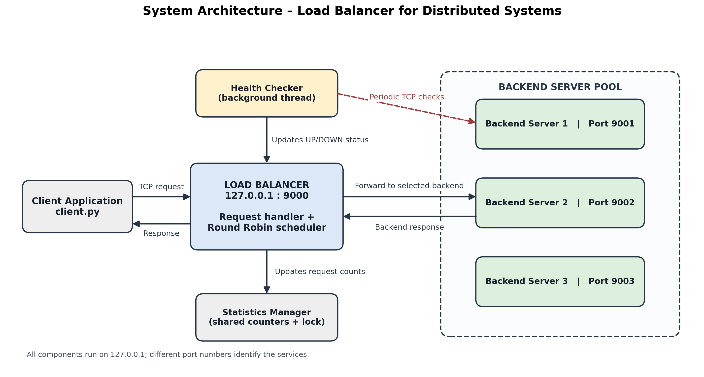

# Python-Based TCP Load Balancer

A multithreaded TCP load balancer implemented using Python socket programming. The system distributes incoming client requests across multiple backend servers using the **Round Robin scheduling algorithm** and provides backend health monitoring, automatic failover, server recovery detection, and request statistics.

## 1. Project Overview

In a distributed system, multiple clients may send requests to a server simultaneously. If all requests are handled by a single server, it can become overloaded, resulting in increased response time or service unavailability.

A load balancer helps address this problem by distributing incoming requests across multiple backend servers.

This project implements a TCP-based load balancer that acts as an intermediary between clients and backend servers. It receives client requests, selects an available backend server using Round Robin scheduling, forwards the request, and returns the backend response to the client.

The system also monitors backend availability and automatically handles server failures by selecting another healthy backend.

## 2. Problem Statement

To design and implement a TCP load balancing system that distributes client requests across multiple backend servers while maintaining service availability through health monitoring, failover, and recovery mechanisms.

The system should also support concurrent client connections and maintain request statistics to monitor server performance.

## 3. Objectives

- Implement TCP-based client-server communication using Python sockets.
- Distribute incoming requests using the Round Robin algorithm.
- Support multiple backend servers.
- Handle multiple client connections using multithreading.
- Monitor backend server availability through periodic health checks.
- Detect backend failures and perform automatic failover.
- Detect recovered backend servers and make them available again.
- Maintain request-level and backend-level statistics.

## 4. System Architecture

The system consists of a client application, a load balancer, a Round Robin scheduler, a backend server pool, a health checker, and a statistics manager.

### Architecture Diagram



### Main Components

| Component | Responsibility |
|---|---|
| Client | Sends requests to the load balancer. |
| Load Balancer | Accepts client connections and forwards requests to backend servers. |
| Round Robin Scheduler | Selects the next available backend server. |
| Backend Server Pool | Contains three backend servers that process requests. |
| Health Checker | Periodically checks backend server availability. |
| Failover Mechanism | Selects another available backend if a connection fails. |
| Statistics Manager | Maintains request and backend statistics. |

### Server Configuration

| Component | Host | Port |
|---|---|---:|
| Load Balancer | 127.0.0.1 | 9000 |
| Server 1 | 127.0.0.1 | 9001 |
| Server 2 | 127.0.0.1 | 9002 |
| Server 3 | 127.0.0.1 | 9003 |

## 5. Technologies and Concepts Used

### Technologies

- **Programming Language:** Python
- **Networking:** TCP Socket Programming
- **Concurrency:** Python Threading
- **Scheduling Algorithm:** Round Robin
- **Testing:** Python unittest
- **Version Control:** Git and GitHub

The implementation uses Python's standard library and does not require third-party packages.

### Core Concepts

**1. TCP Socket Programming**

TCP provides reliable, connection-oriented communication between the client, load balancer, and backend servers.

The Python `socket` module is used for establishing connections and transferring data.

**2. Client-Server Architecture**

The client sends requests to the load balancer instead of communicating directly with individual backend servers.

The load balancer acts as an intermediary and forwards requests to the selected backend.

**3. Round Robin Scheduling**

The Round Robin algorithm distributes requests cyclically among available backend servers.

For example:

Request 1 → Server 1  
Request 2 → Server 2  
Request 3 → Server 3  
Request 4 → Server 1  

Unavailable servers are skipped during selection.

**4. Multithreading**

A separate thread is created for every accepted client connection. This allows multiple client requests to be handled concurrently.

**5. Health Checking**

A background thread periodically checks whether backend servers accept TCP connections.

- Health check interval: 2 seconds
- Connection timeout: 1 second

**6. Fault Tolerance**

When a selected backend connection fails, the load balancer marks that backend as DOWN and attempts to forward the request to another available backend.

The health checker can subsequently detect when the failed backend becomes reachable again.

## 6. Working Process

The system follows these steps:

1. The client establishes a TCP connection with the load balancer.
2. The load balancer accepts the connection.
3. A separate thread handles the client request.
4. The request counter is incremented.
5. The Round Robin scheduler selects the next healthy backend.
6. The load balancer establishes a TCP connection with the selected backend.
7. The request is forwarded to the backend server.
8. The backend processes the request and sends a response.
9. The load balancer forwards the response to the client.
10. Request statistics are updated.

If a backend connection fails:

1. The backend is marked as DOWN.
2. Its failure count is incremented.
3. The scheduler selects another available backend.
4. The request is retried if another backend is available.
5. The health checker continues monitoring the failed backend.
6. When the backend becomes reachable again, it is marked as UP and becomes eligible for future requests.

### Request Processing Flowchart


### Health Checking Flowchart


## 7. Project Structure

```text
Python-Load-Balancer/
│
├── backend_server.py
│
├── client.py
│
├── loadbalancer.py
│
├── test_loadbalancer.py
│
├── README.md
│
├── requirements.txt
│
└── docs/
    ├── system_architecture.png
    ├── request_flowchart.png
    └── health_check_flowchart.png
```

### File Descriptions

| File | Description |
|---|---|
| `backend_server.py` | Implements the backend server that receives and processes client requests. |
| `client.py` | Implements the client application that sends requests to the load balancer. |
| `loadbalancer.py` | Contains the main load balancer, scheduler, health checker, failover logic, multithreading, and statistics. |
| `test_loadbalancer.py` | Contains unit tests for the load balancing scheduler and related behavior. |
| `README.md` | Project documentation. |
| `docs/` | Contains system architecture and flowchart diagrams. |

## 8. Implementation Details

### Round Robin Scheduler

The `RoundRobinScheduler` class maintains the list of backend servers and their availability status.

It uses a circular index to select the next eligible backend.

The scheduler also uses a thread lock to protect shared server status and scheduling information.

### Backend Health Monitoring

The `check_backend()` function attempts to establish a TCP connection with a backend server.

The `check_all_backends()` function checks all configured backend servers and updates their availability status.

The `health_check_loop()` function runs periodically in a background thread.

### Failover and Recovery

The request handler maintains an `attempted` set to prevent retrying the same backend multiple times for a single client request.

If a backend connection fails, it is marked as DOWN, and the scheduler attempts to select another healthy backend.

When the health checker detects that a previously unavailable server is accepting TCP connections again, it marks that backend as UP.

### Concurrent Client Handling

The load balancer creates a separate thread for every accepted client connection.

This allows the system to process multiple client connections concurrently.

### Request Statistics

The system maintains the following statistics:

- Total requests received.
- Successful requests.
- Failed requests.
- Retry attempts.
- Successful requests handled by each backend.
- Backend connection failures for each server.

Thread locks are used to protect shared statistics during concurrent execution.

## 9. Setup and Execution

### Prerequisites

- Python 3 installed.
- Git installed.
- A terminal or code editor such as VS Code.

### Step 1: Clone the Repository

```bash
git clone https://github.com/YOUR_USERNAME/Python-Load-Balancer.git
```

Navigate into the project directory:

```bash
cd Python-Load-Balancer
```

### Step 2: Verify Python Installation

```bash
python3 --version
```

### Step 3: Start Backend Servers

Open separate terminal windows for the three backend servers.

Run the backend server program:

```bash
python3 backend_server.py
```

Start three instances, ensuring that each is configured to listen on its respective port:

- Server 1: 9001
- Server 2: 9002
- Server 3: 9003

**Note:** The exact command-line arguments depend on the implementation in `backend_server.py`. Configure or pass the server name and port as supported by that file.

### Step 4: Start the Load Balancer

Open another terminal and execute:

```bash
python3 loadbalancer.py
```

The load balancer starts listening on:

```text
127.0.0.1:9000
```

It performs an initial health check and starts a background health-checking thread.

### Step 5: Start the Client

Open another terminal and execute:

```bash
python3 client.py
```

The client should connect to the load balancer at `127.0.0.1:9000` and send requests.

Follow any prompts provided by the client program.

**Important:** The client and backend execution commands above assume their scripts use these default configurations. Refer to their implementations if they require command-line arguments.

## 10. Testing and Evaluation

The project can be evaluated using the following scenarios:

| Test Scenario | Expected Behavior |
|---|---|
| Normal request handling | Requests are distributed among available backend servers. |
| Round Robin scheduling | The scheduler selects servers in cyclic order. |
| Backend failure | An unavailable backend is skipped or marked DOWN after a connection failure. |
| Automatic failover | The load balancer attempts another eligible backend. |
| Backend recovery | A reachable backend is marked UP again. |
| Concurrent requests | Multiple client connections are handled using separate threads. |
| All backends unavailable | The client receives an error response. |
| Statistics tracking | Request and backend statistics are updated. |

### Running Unit Tests

Execute the following command from the project directory:

```bash
python3 -m unittest -v test_loadbalancer.py
```

The test suite is intended to verify scheduler behavior, including:

- Round Robin rotation.
- Skipping unavailable backends.
- Handling situations where all backends are DOWN.
- Backend recovery.
- Excluding previously attempted backends.

### Manual Testing

The system can also be tested by:

1. Starting all three backend servers.
2. Sending multiple client requests.
3. Stopping one backend server.
4. Sending additional requests and observing failover.
5. Restarting the stopped backend.
6. Observing its recovery through the health checker.
7. Checking the final request statistics.

## 11. Performance and Statistics

The load balancer tracks request processing and backend connection statistics.

The following metrics are maintained:

| Metric | Description |
|---|---|
| Total Requests | Number of client requests received. |
| Successful Requests | Number of requests successfully processed by a backend. |
| Failed Requests | Number of client requests that could not be completed. |
| Retry Attempts | Number of additional backend attempts made after the first attempt. |
| Backend Success | Number of successful requests handled by each backend. |
| Backend Failures | Number of failed connection attempts for each backend. |

These statistics help evaluate request distribution and failure-handling behavior.

## 12. Limitations and Future Enhancements

### Current Limitations

- The system uses local loopback addresses and is designed for local execution.
- Round Robin does not consider the current workload or processing capacity of individual servers.
- Health checks verify TCP connection availability, not the complete application health of a backend.
- The load balancer itself is a single point of failure.
- The implementation does not include encrypted communication or authentication.
- Request forwarding currently uses a simple message-response exchange rather than a complete production-grade HTTP protocol implementation.

### Future Enhancements

- Implement Weighted Round Robin scheduling.
- Explore Least Connections scheduling.
- Add response-time and server-load monitoring.
- Introduce a web-based monitoring dashboard.
- Support deployment across multiple machines.
- Add secure communication and authentication.
- Introduce redundant load balancers for higher availability.

## 13. Learning Outcomes

Through this project, the following concepts were implemented and explored:

- TCP communication using socket programming.
- Client-server architecture.
- Load balancing and request distribution.
- Round Robin scheduling.
- Multithreaded request processing.
- Backend health monitoring.
- Fault tolerance through failover and recovery.
- Synchronization of shared resources using thread locks.
- Unit testing and system-level evaluation.

## 14. Conclusion

This project demonstrates the design and implementation of a TCP-based load balancer using Python.

By combining Round Robin scheduling, multithreaded client handling, periodic backend health checks, automatic failover, and recovery detection, the system provides a basic mechanism for distributing client requests across multiple backend servers.

The project provides practical experience in socket programming, networking, concurrency, scheduling algorithms, and fault-tolerant system design.

## 15. References

1. Python Documentation – Socket Programming: https://docs.python.org/3/library/socket.html
2. Python Documentation – Threading: https://docs.python.org/3/library/threading.html
3. Python Documentation – Unit Testing: https://docs.python.org/3/library/unittest.html
4. RFC 9293 – Transmission Control Protocol (TCP): https://www.rfc-editor.org/rfc/rfc9293
5. Kurose, J. F., and Ross, K. W., *Computer Networking: A Top-Down Approach*.